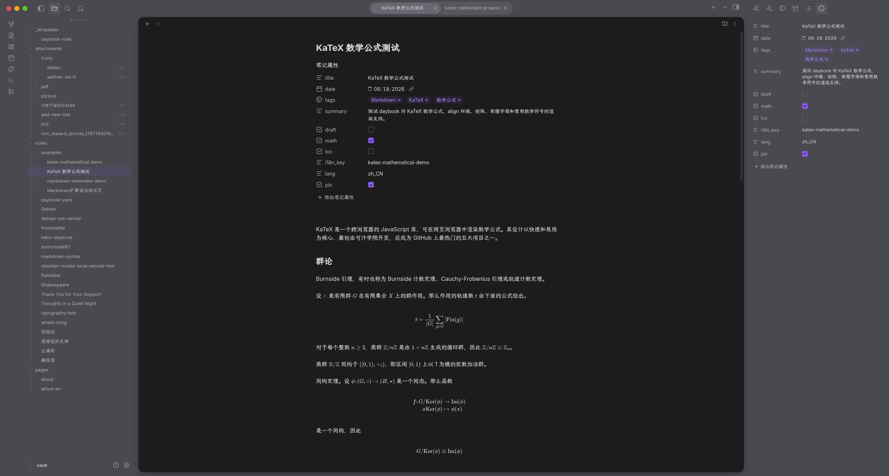

# Violet

Violet 是面向 Linux 桌面 Obsidian 的静态主题。它以安静的顶部和侧栏围绕一张不透明的写作卡片，提供紧凑药丸标签页、圆角菜单和 macOS 风格的窗口按钮。Markdown 正文沿用 Obsidian 默认排版。

## 效果预览

浅色模式：


深色模式：



## 单命令安装与更新（含玻璃效果）

支持 Linux 桌面、标准 `/opt/Obsidian` 安装，以及支持 `blur`、`background-effect` 语法的修改版 niri（本项目实测为 niri 26.04 modified）。不支持普通不含模糊功能的 niri、其他合成器、Flatpak、Snap 或 Obsidian 自定义配置目录。

准备 Python 3.9+、Node.js 22.12+ 和 npm，并确保已有可用的 `~/.config/niri/config.kdl`。脚本不会安装系统软件或使用 sudo。首次准备 npm 依赖需要网络。

**完全退出 Obsidian**，然后运行：

```sh
git clone https://github.com/StatIndet/obsidian-violet.git
cd obsidian-violet
./install.sh "/绝对路径/Obsidian Vault"
```

脚本会：

- 将已生成的主题文件安装到 Vault 的 `.obsidian/themes/Violet/`，启用 Violet 和 `violet-native-glass` CSS 片段，保留其他外观设置。
- 给用户目录的 Obsidian 应用包添加 Electron 主窗口透明参数；没有用户更新包时，从系统应用包创建用户副本，不修改系统文件。
- 安装 `~/.config/niri/violet.kdl` 并加入 include；沿用现有全局 blur 参数，没有时添加示例参数。
- 停用本项目旧版已知的自动维护单元和启动拦截，保留历史备份。自行修改过的旧文件不会被覆盖，需要手动清理。

完成后重新打开 Obsidian。每个 Vault 分别执行安装，宿主补丁和 niri 规则由同一 Linux 用户共享。安装会更新项目拥有的主题、片段及 `violet.kdl`；个人 niri 规则请放在其他文件中。

**Obsidian 更新后透明效果消失：退出应用，再运行同一条 `./install.sh` 命令。** 主题代码通常无需改变。要获取仓库的新适配器，先执行 `git pull`。重复运行不会叠加透明补丁，也不会重复加入片段或 include。脚本没有自动备份、后台监听、定时任务、启动拦截或自动重启。

透明补丁是对 Obsidian 应用包的非官方修改，位于 `~/.config/obsidian/obsidian-版本.asar`。它与静态 CSS 主题、niri 桌面背景模糊是三个独立环节，中央编辑及阅读表面始终不透明。如果新版窗口构造位置无法唯一识别，安装会报错，需要更新适配器，不能保证未知未来版本只靠重跑就能兼容。补丁工具仅在安装时运行，不会向 Obsidian 安装插件或运行时脚本。

### 回滚玻璃效果

1. 在 Obsidian 的外观设置中停用 `violet-native-glass` CSS 片段，然后完全退出应用。
2. 从 `~/.config/niri/config.kdl` 移除 `include "violet.kdl"`，删除 `~/.config/niri/violet.kdl`；若安装时新增了带 Violet 注释的全局 blur 块，可一并移除。
3. 删除安装输出中对应的 `~/.config/obsidian/obsidian-版本.asar`。如有多个曾适配的版本，也需移除，否则加载器可能选中旧补丁包；通过官方安装器或官方应用更新恢复原始应用包。删除用户更新包后，应用可能暂时使用系统自带的较旧版本，必要时先更新官方安装器。

本方案不生成备份，不能从脚本恢复安装前的自定义外观或 niri 配置。Violet 主题本身可以继续使用；若要卸载主题，在设置中切回默认主题并删除 Vault 的 `.obsidian/themes/Violet/` 和对应 CSS 片段即可。

## 仅安装静态主题

从 [最新 Release](https://github.com/StatIndet/obsidian-violet/releases/latest) 下载 `manifest.json` 和 `theme.css`，放入 Vault 的 `.obsidian/themes/Violet/`，在外观设置中选择 Violet。此方式无需 npm、Python 或插件，使用实色外壳，不应用宿主透明补丁或 niri 模糊规则。更新时替换同一目录的两个文件。

## 开发

```sh
npm ci
npm run build
npm run test:install
npm run test:vault
npm run install:test
```

`src/theme.scss` 是唯一 Sass 入口，生成根目录 `theme.css`。`manifest.json` 与生成的 CSS 一起提交；CI 会检查版本一致性及构建结果。`test-vault/` 仅供隔离验证，不进入仓库。`scripts/create-test-vault.sh` 使用 `tests/markdown-baseline.md` 创建不含个人笔记的基线 Vault。

`src/` 保存主题源码，`integration/` 保存安装器使用的玻璃配置，`.github/workflows/` 保存 CI 与 Release 工作流。红绿灯按钮图像的来源与许可见 [第三方资源说明](THIRD_PARTY_NOTICES.md)。

## 许可

Violet 本身采用 [MIT 许可证](LICENSE)。嵌入的 MacTahoe GTK 按钮素材保留其原始 MIT 声明，详见[第三方资源说明](THIRD_PARTY_NOTICES.md)。
